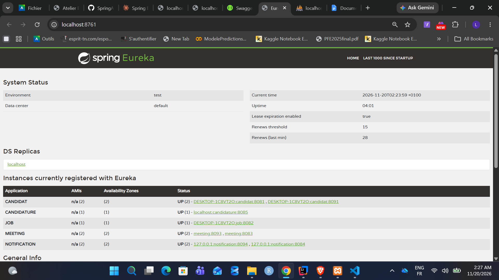

# awd-lab

## Team
- Lyna Moujahed
- Mouhamed Ayoub Hajri
- Ayoub Maatoug
- Tenkwa Njanda P

## Architecture

| Microservice | Technology | Port | Eureka name |
|---|---|---|---|
| Eureka Server | Spring Boot | 8761 | none |
| Candidat | Spring Boot + H2 | 8081 | CANDIDAT |
| Job | Spring Boot + MySQL | 8082 | JOB |
| Candidature | Spring Boot + MySQL | 8085 | CANDIDATURE |
| Meeting | Node.js / Express | 8083 | MEETING |
| Notification | Python / FastAPI | 8084 | NOTIFICATION |

## How to run

1. Start MySQL (needed for Job and Candidature).
2. Start `eureka` (http://localhost:8761).
3. Start `candidat`, `job`, `candidature` (Spring Boot).
4. Meeting: `cd meeting && npm install && node index.js`
   Second instance: `$env:PORT=8093; node index.js`
5. Notification: `cd notification && pip install -r requirements.txt && python main.py`
   Second instance: `$env:PORT=8094; python main.py`

## Eureka dashboard

