# awd-lab

## Team
- Lyna Moujahed
- Mouhamed Ayoub Hajri
- Ayoub Maatoug
- Tenkwa Njanda P

# Distributed Web Architecture: Eureka and Spring Boot Actuator
# awd-lab

## Team
- Lyna Moujahed
- Mouhamed Ayoub Hajri
- Ayoub Maatoug
- Tenkwa Njanda P

This project covers two labs on the same microservices application:

1. **Eureka server**: service discovery for Spring Boot, Node.js and Python microservices.
2. **Spring Boot Actuator**: observability (health, info, metrics, loggers) and health reporting to Eureka.

## Architecture

| Microservice | Technology | Port | Name in Eureka |
|---|---|---|---|
| Eureka Server | Spring Boot | 8761 | none |
| Candidat | Spring Boot + H2 | 8081 | CANDIDAT |
| Job | Spring Boot + MySQL | 8082 | JOB |
| Meeting | Node.js / Express | 8083 | MEETING |
| Notification | Python / FastAPI | 8084 | NOTIFICATION |
| Canditature | Spring Boot | 8085 | CANDITATURE |

**Start order:** MySQL (XAMPP/WAMP), then Eureka, then Candidat, Canditature, Job, Meeting and Notification.

## How to run

- **Spring Boot services**: run the `*Application` class in IntelliJ.
- **Meeting**: `cd meeting`, `npm install`, `npm start`.
- **Notification**:
  ```powershell
  cd notification
  python -m venv venv
  .\venv\Scripts\Activate.ps1
  pip install -r requirements.txt
  python -m uvicorn app.main:app --port 8084
  ```
- **Second instances**: Candidat with `-Dserver.port=8091`; Meeting with `$env:PORT=8093`; Notification with `$env:PORT=8094` and `--port 8094`.

---

# Part 1: Eureka server

## 1.1 Eureka server

`EurekaApplication` is annotated with `@EnableEurekaServer`. Configuration (`application.properties`):

```properties
spring.application.name=eureka
server.port=8761
eureka.client.register-with-eureka=false
eureka.client.fetch-registry=false
```

The dashboard at `http://localhost:8761` shows no instance before any client is started.

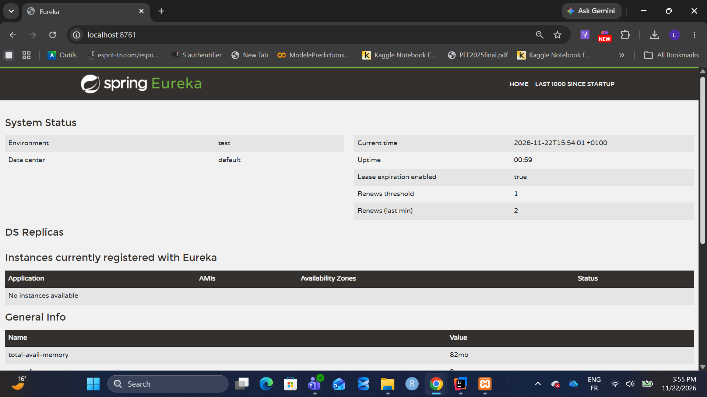

## 1.2 Spring Boot clients (Candidat, Job, Canditature)

The dependency `spring-cloud-starter-netflix-eureka-client` was added to each service, with this configuration:

```properties
eureka.client.service-url.defaultZone=http://localhost:8761/eureka
eureka.client.register-with-eureka=true
eureka.client.fetch-registry=true
eureka.instance.prefer-ip-address=true
```

CANDIDAT, CANDITATURE and JOB are registered and UP:

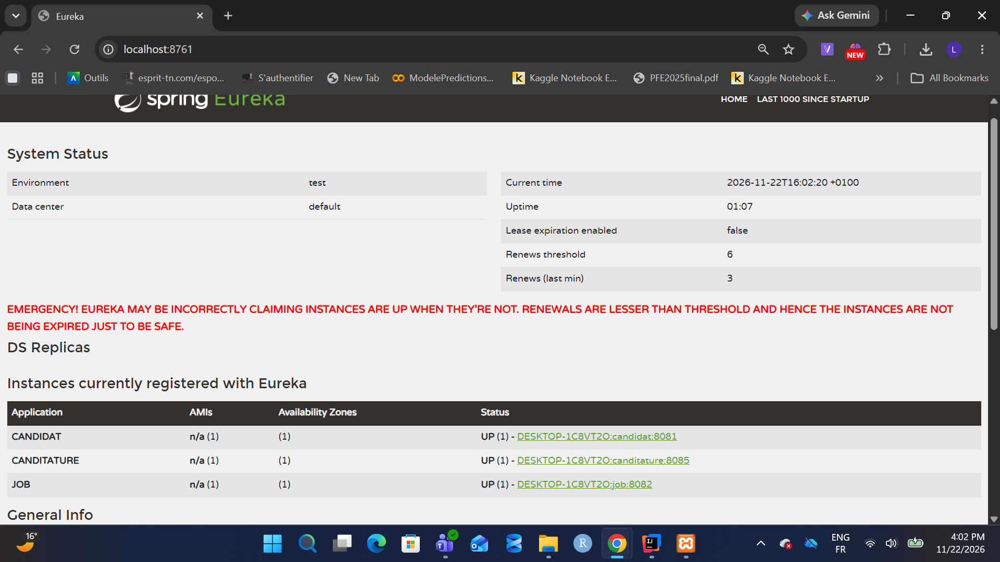

## 1.3 Several instances of a microservice

A second instance of Candidat was started on port 8091 with `-Dserver.port=8091`. Eureka lists both under the same name, CANDIDAT (UP (2)). Each instance has its own in-memory H2 database, so their data is independent.

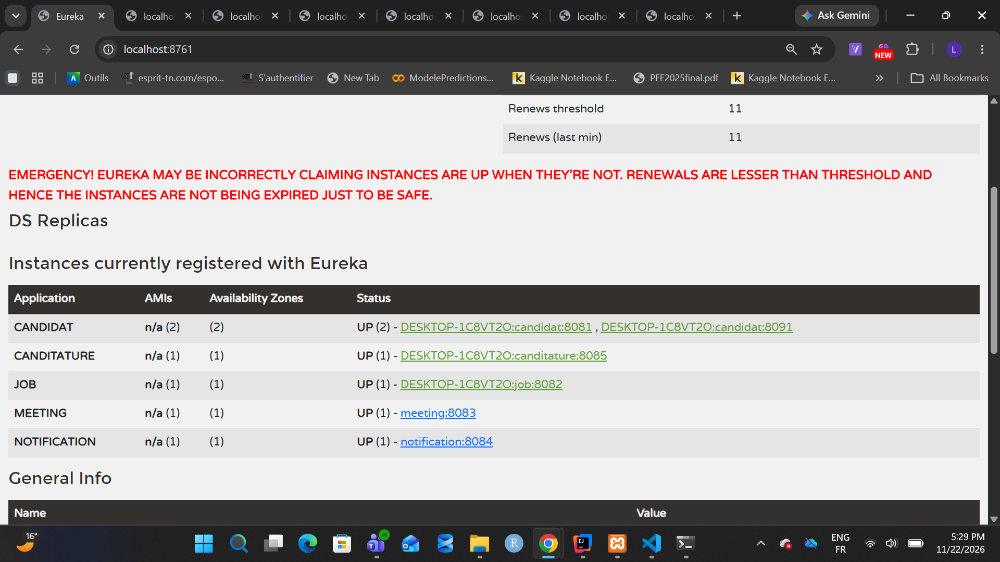

## 1.4 Node.js client (Meeting)

The service registers with `eureka-js-client` under the name MEETING. The port is read from the `PORT` environment variable and the `instanceId` includes the port, so several instances can run at the same time.

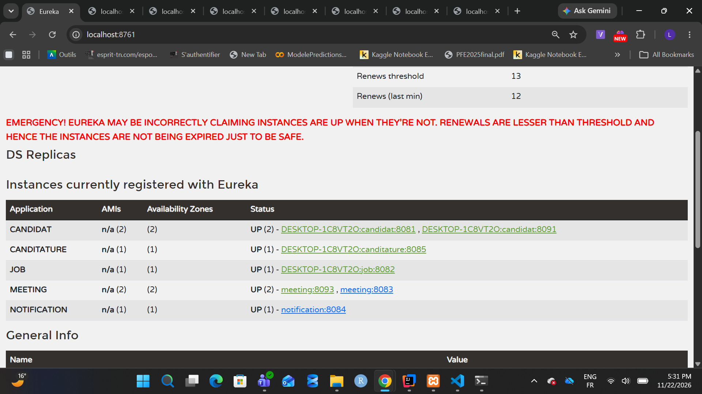

## 1.5 Python client (Notification)

The service registers with `py-eureka-client` under the name NOTIFICATION, inside the FastAPI `lifespan` handler. It registers at startup and unregisters at shutdown. The port comes from the `PORT` environment variable.

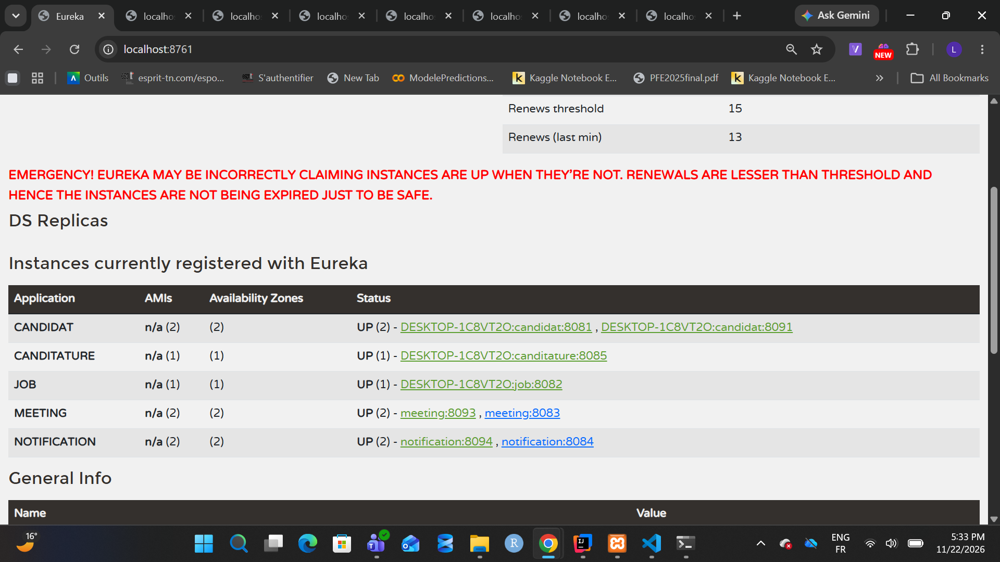

## 1.6 Final dashboard

All services are visible at the same time in the dashboard, with several instances of Candidat, Meeting and Notification.

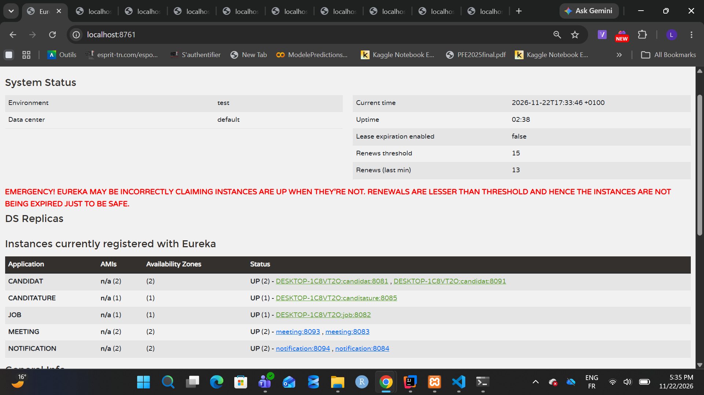

All five services together:

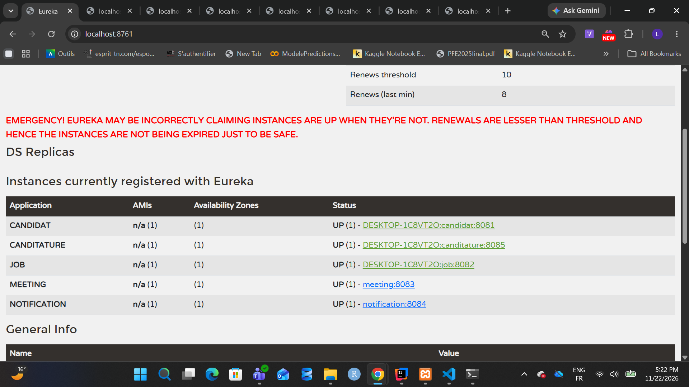

> The red "EMERGENCY! EUREKA MAY BE INCORRECTLY CLAIMING INSTANCES ARE UP" banner is Eureka's self-preservation mode. It appears because the number of renewals is below the expected threshold, which is normal on a small local setup.

---

# Part 2: Observability with Spring Boot Actuator

## 2.1 Setting up Actuator

The dependency `spring-boot-starter-actuator` was added to Candidat, Job and Canditature. Configuration added to each `application.properties`:

```properties
# Expose the endpoints (only health is exposed by default)
management.endpoints.web.exposure.include=health,info,metrics
# Show component details in /health
management.endpoint.health.show-details=always
# Send the /health status to Eureka
eureka.client.healthcheck.enabled=true
# Publish info.* properties in /actuator/info
management.info.env.enabled=true

info.app.name=candidat
info.app.version=1.0.0
info.app.description=Microservice de gestion des candidats
```

For Candidat, `loggers` was added to the exposure list (see section 2.5).

## 2.2 `/actuator/info`

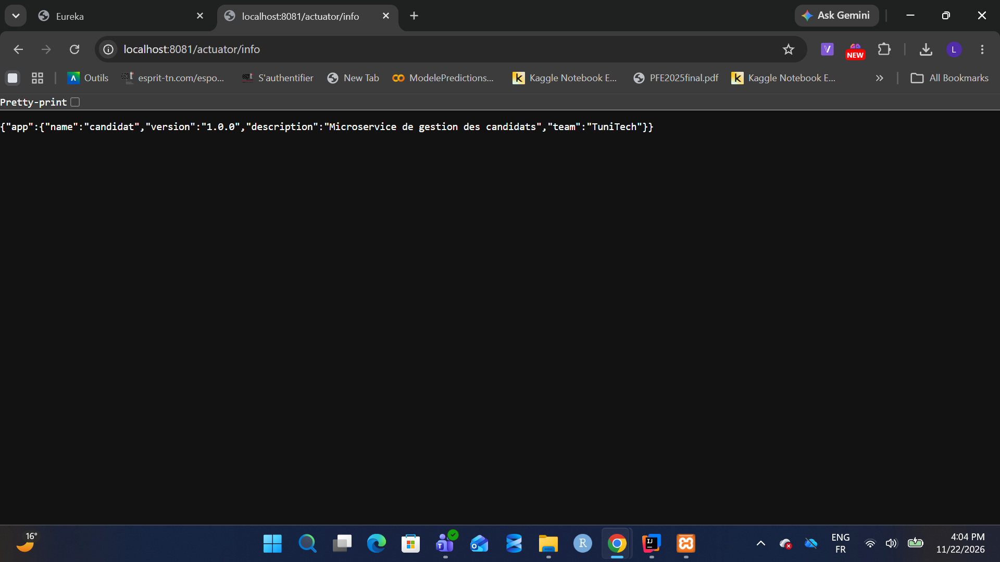

The dashboard link of each instance points to `/actuator/info` by default.

## 2.3 `/actuator/health` and MySQL failure

With MySQL running, Job is UP, with `db`, `diskSpace`, `ping` and the other components all UP:

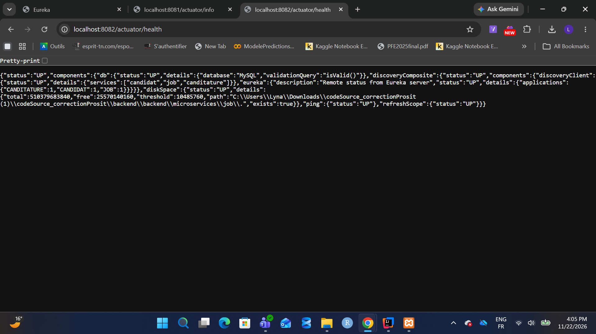

After stopping MySQL, the Job process keeps running, but its health becomes **DOWN** (HTTP 503), because the `db` component fails:

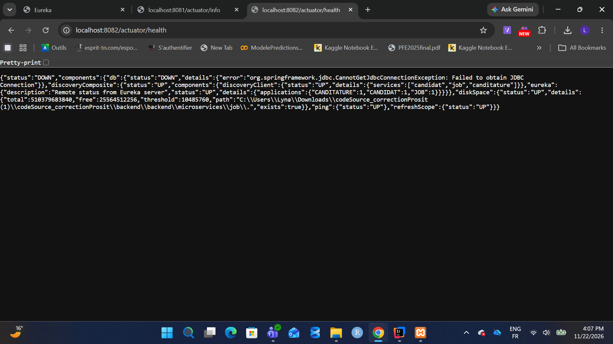

Because `eureka.client.healthcheck.enabled=true`, Eureka shows JOB as **DOWN** after the next heartbeat. Without this property, the instance would stay UP in the dashboard even with its database down.


After restarting MySQL, Job returns to UP:

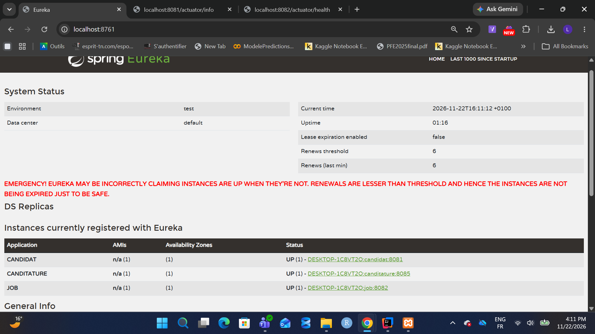

## 2.4 `/actuator/metrics`

List of available metrics:

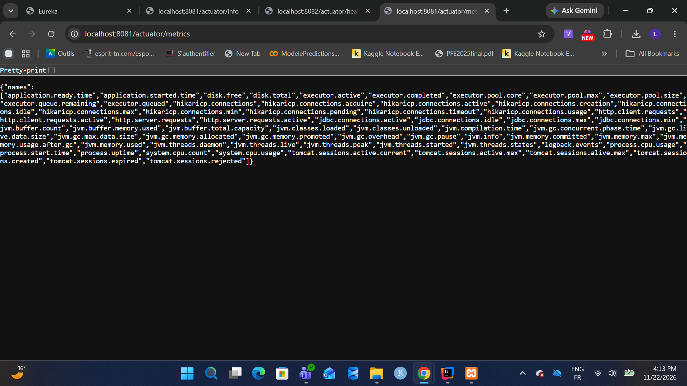

A specific metric, `jvm.memory.used`:

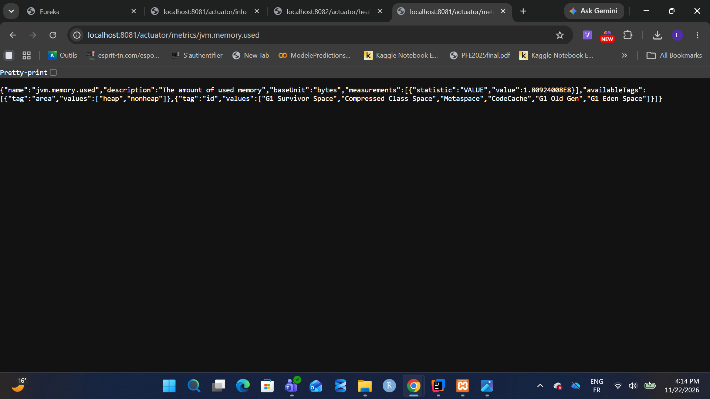

HTTP requests, `http.server.requests`:

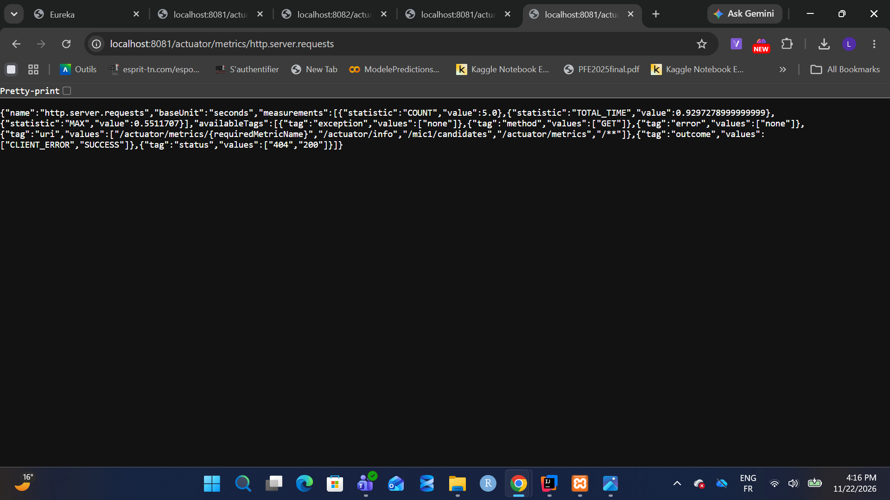

Filtered by status, `http.server.requests?tag=status:200`:

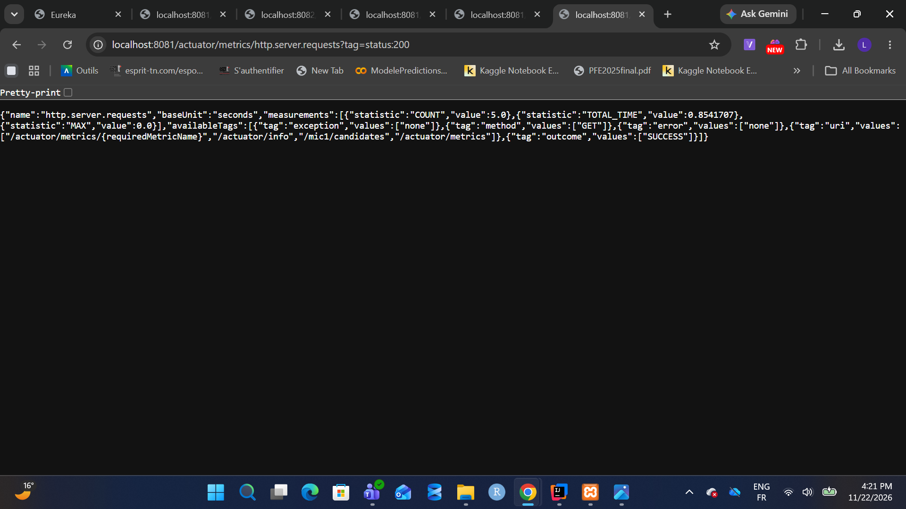

### Answers to the lab question

- **How many HTTP requests did Candidat handle (COUNT)?**
  `COUNT` = **5**. This includes calls to `/mic1/candidates` and to the Actuator endpoints themselves (`/actuator/info`, `/actuator/metrics`), since Actuator requests are measured too.
- **Duration of the slowest request (MAX)?**
  `MAX` = **0.55 s** (about 551 ms). It is most likely the first call to `/mic1/candidates`, which includes the one-time initialization of Hibernate and the connection pool.
- **What does `?tag=status:200` give?**
  It filters the metric to successful requests only (`outcome: SUCCESS`). Here `COUNT` = 5 and `TOTAL_TIME` ≈ 0.85 s, and the 404 responses are excluded. `MAX` shows 0.0 because it is a short-window maximum that has already decayed, not because no request was slow.

## 2.5 `/actuator/loggers`: changing a log level without restarting

`loggers` was added to `management.endpoints.web.exposure.include`.

1. Reading the logger `org.hibernate.SQL`: its effective level is INFO, so Hibernate does not print SQL queries.

   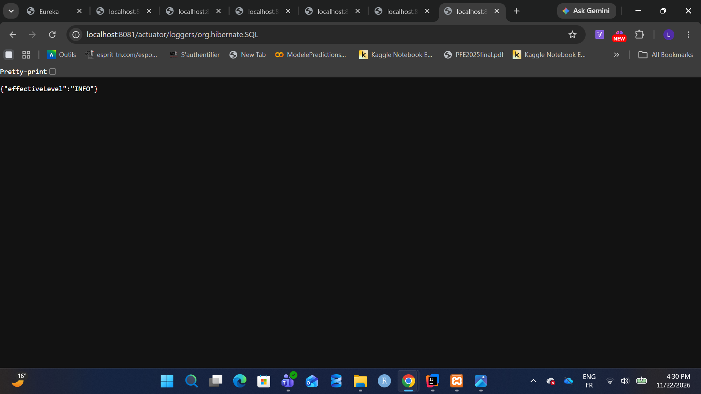

2. Changing the level to DEBUG with a POST request:

   ```powershell
   curl.exe -X POST http://localhost:8081/actuator/loggers/org.hibernate.SQL -H "Content-Type: application/json" -d '{\"configuredLevel\":\"DEBUG\"}'
   ```

   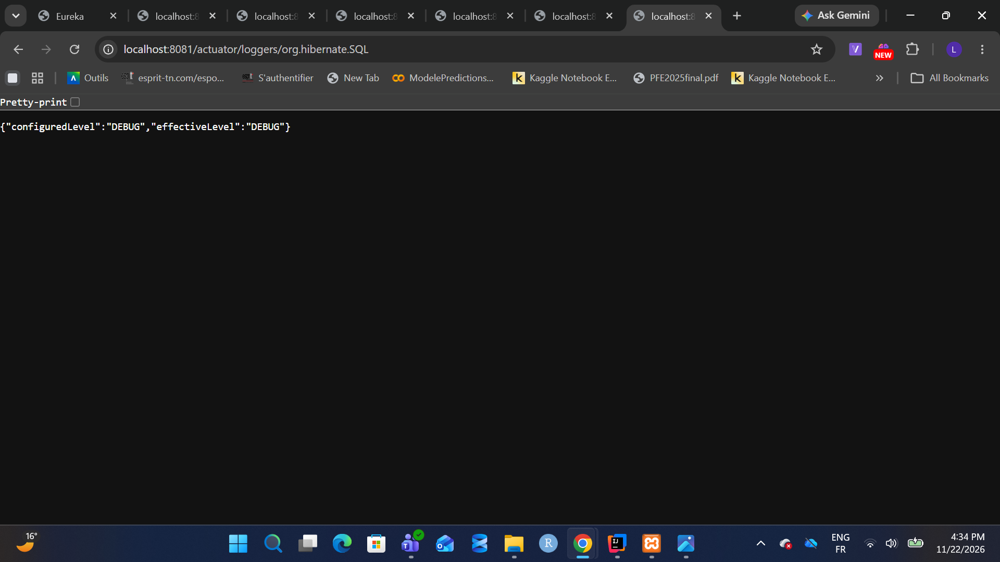

3. The next call to `/mic1/candidates` prints the SQL query in the console, with no restart:

   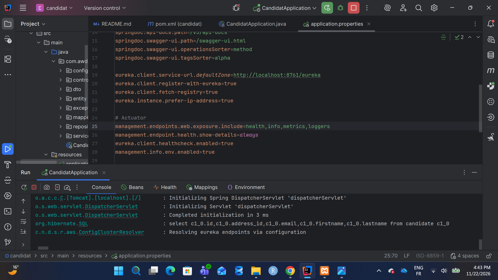

4. Reset: POST with `{"configuredLevel":null}`.

The change lives in memory only: a restart returns the logger to its default level.

## 2.6 Custom HealthIndicator (Job)

`JobsHealthIndicator` implements `HealthIndicator` and is registered as a Spring bean. It counts the rows of the `job` and `category` tables, returns UP with those counts as details, and returns DOWN with a reason if the query fails. Spring Boot adds it to `/actuator/health` under the name `jobs`, and it takes part in the global status like the built-in components.

```java
@Component
public class JobsHealthIndicator implements HealthIndicator {

    private final JobRepository jobRepository;
    private final CategoryRepository categoryRepository;

    public JobsHealthIndicator(JobRepository jobRepository, CategoryRepository categoryRepository) {
        this.jobRepository = jobRepository;
        this.categoryRepository = categoryRepository;
    }

    @Override
    public Health health() {
        try {
            return Health.up()
                    .withDetail("jobs", jobRepository.count())
                    .withDetail("categories", categoryRepository.count())
                    .build();
        } catch (Exception e) {
            return Health.down(e)
                    .withDetail("reason", "Cannot read the job tables")
                    .build();
        }
    }
}
```

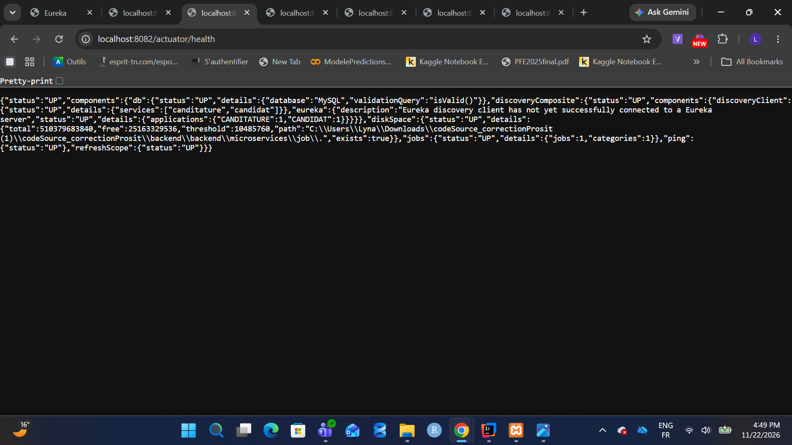

## 2.7 Health of the Node.js and Python services (Part 5)

Meeting and Notification do not use Spring Boot, so their health endpoints were written by hand and declared in Eureka during registration.

### Meeting (Node.js / Express)

- `GET /health` returns `{"status":"UP"}` with HTTP 200.
- `GET /info` returns the name and version read from `package.json`.
- `healthCheckUrl` and `statusPageUrl` are declared in the `eureka-js-client` configuration.

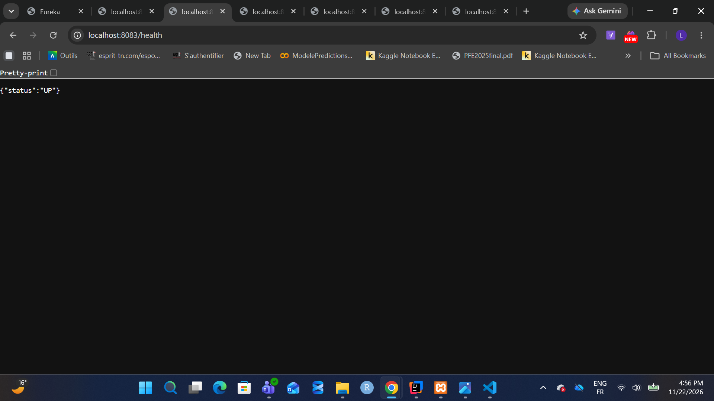

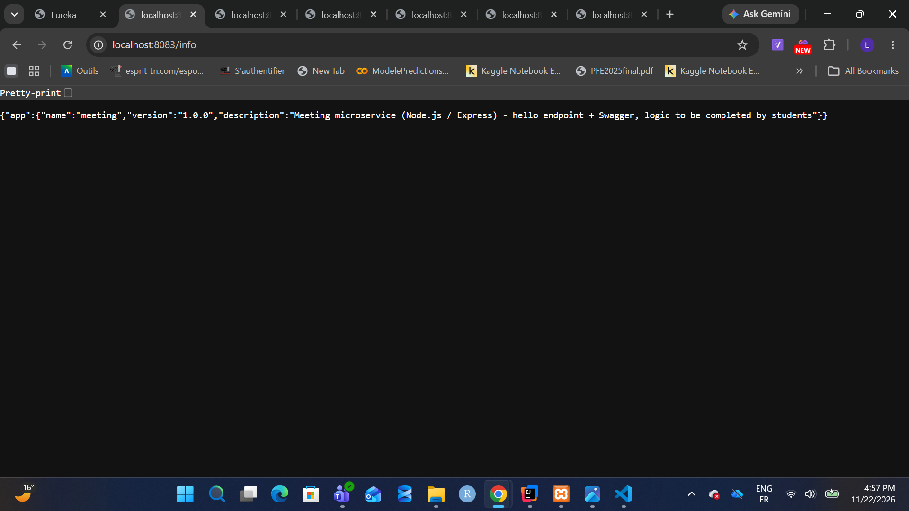

The instance link in the Eureka dashboard opens `/info`:

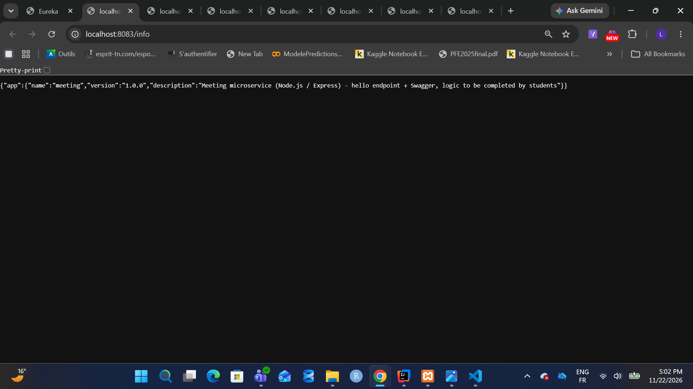

### Notification (Python / FastAPI)

- `GET /health` returns `{"status":"UP"}`.
- `GET /info` returns the name, version and description.
- `health_check_url` and `status_page_url` are declared in `eureka_client.init_async(...)`.

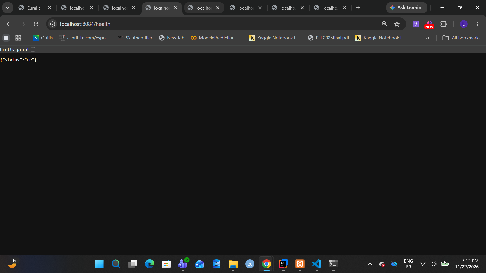

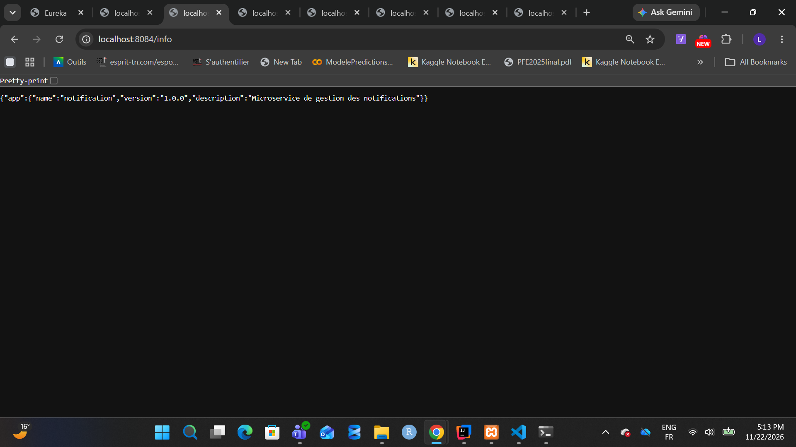

Both URLs appear in the registry (`GET /eureka/apps/NOTIFICATION`):

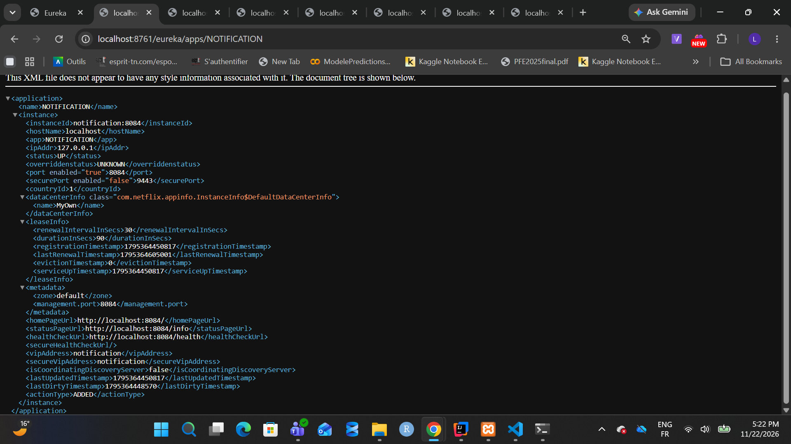

---

